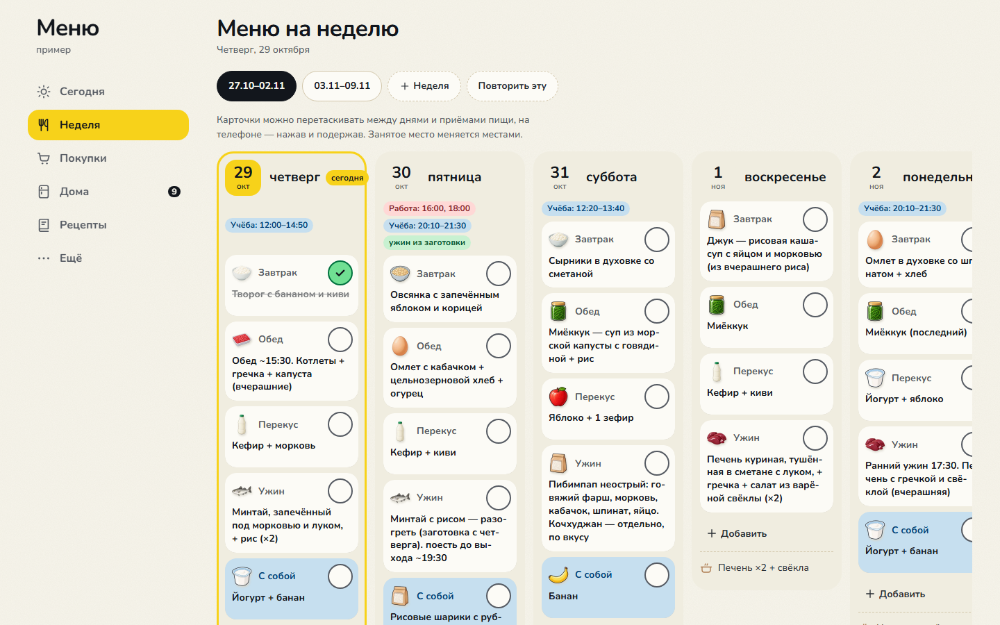
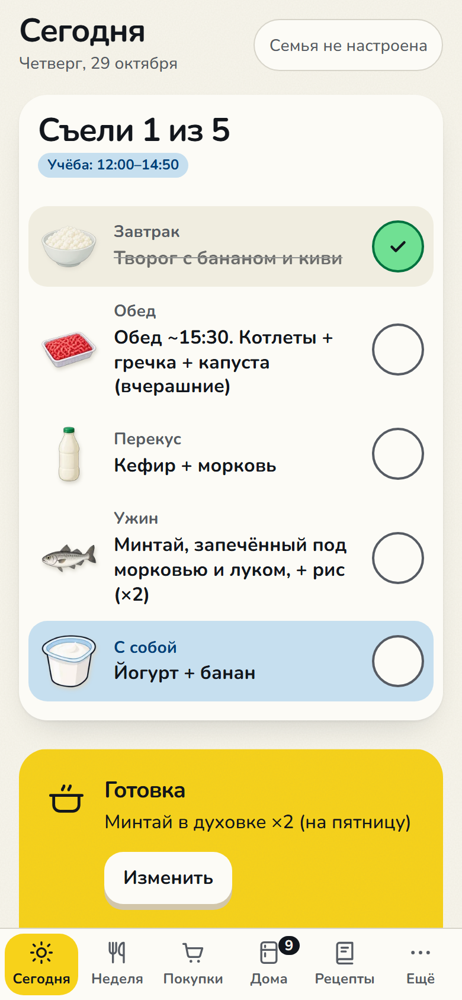
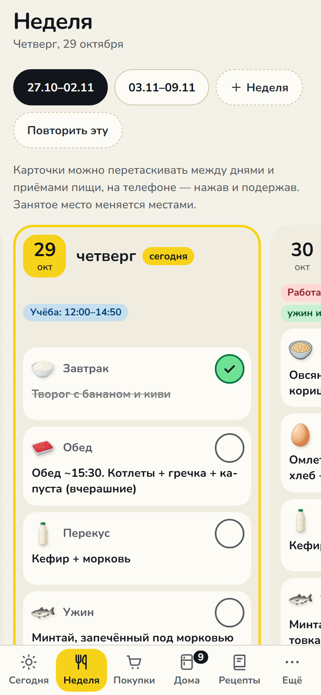
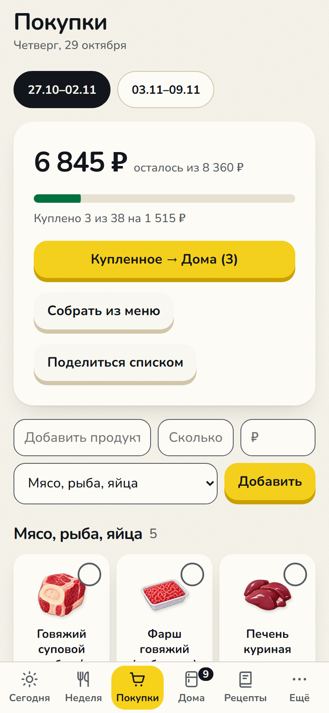
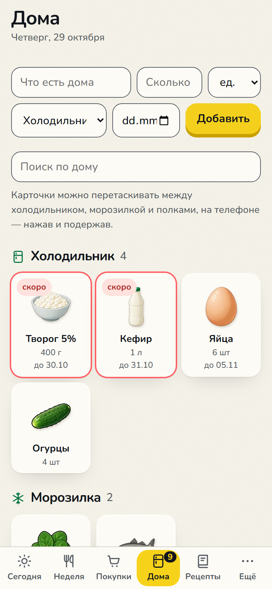
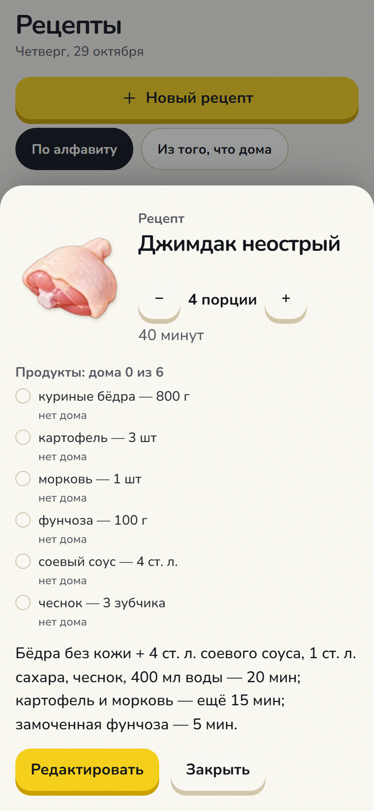
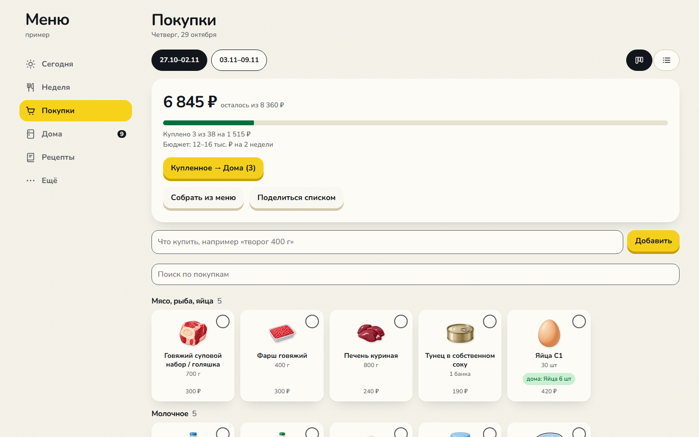

# Меню — планировщик питания для семьи

Меню на неделю, список покупок, продукты дома и рецепты в одном месте. Работает на телефоне и на ПК, без сети тоже. Данные живут **на ваших устройствах**; устройства семьи обмениваются ими через релей со сквозным шифрованием — сервер хранит только шифр и не знает ни имён, ни блюд. Регистрации нет.



<p>
  
  
  
  
  
</p>

<sub>Сегодня · Неделя · Покупки · Дома · Рецепт. Снимки на обезличенном примере: <code>node tools/screenshots.mjs</code></sub>

## Что умеет

- **Сегодня** — что едим сегодня, отметка «съели», план готовки, «Не забыть» (что испортится, что разморозить к завтра, что купить; на ПК — уведомление утром), что можно приготовить из того, что дома, что на завтра.
- **Неделя** — доска как в Notion: колонка на день, карточка на блюдо; карточки перетаскиваются между днями и приёмами пищи, «+ Добавить» — свой приём (например, полдник), «Повторить эту» — та же неделя ещё раз; у блюда — рецепты, время и «из заготовки»; отметка, если в блюде то, на что у кого-то в семье аллергия.
- **Покупки** — «Собрать из меню»: продукты из рецептов блюд недели, сложенные и без того, что уже есть дома; плитки с иконками, отметка «куплено» прямо на плитке, «Поделиться списком» в мессенджер, купленное одним нажатием переносится в «Дома».

  
- **Дома** — холодильник, морозилка, полки, сроки годности; «Закончилось» — и сразу в покупки; после «съели» приложение спросит, что из продуктов рецепта закончилось.
- **Рецепты** — порции и время, список продуктов с отметкой «есть дома», «−/+» порции пересчитывают количества, порядок «что приготовить из того, что дома»; свои картинки (хранятся только на устройстве).
- **Семья** — карточки членов семьи с фото: аллергии, вес и заметка о питании дополнительно шифруются семейным паролем (AES-GCM); фото ходит только между устройствами семьи.
- **Устройства** — новое устройство подключается по QR-коду или ссылке; 12 слов — запасной ключ. По желанию ключ можно сохранить в своём Google-аккаунте и входить на своих устройствах через «Войти через Google».
- **Google Таблица** (по желанию) — обмен по кнопке: выгрузить меню в таблицу, поправить там (или попросить Claude либо другого ИИ-агента — памятка по формату есть в приложении) и забрать обратно.
- Удаления и переносы можно отменить из сообщения внизу экрана. Светлая и тёмная тема.

## Как начать

1. Откройте приложение и во вкладке «Ещё» нажмите «Создать семью».
2. На другом устройстве отсканируйте QR-код или откройте ссылку из «Добавить устройство».

Установка: на телефоне — «Поделиться» → «На экран Домой» (iPhone) или «Добавить на главный экран» (Android); на Windows — установщик `Menu_*_x64-setup.exe` из [релизов](../../releases), обновляется сам.

> Для своей семьи лучше сделать форк: свой релей на Cloudflare Workers (бесплатного тарифа хватает, ~5 минут: [relay/README.md](relay/README.md)) и, если нужна таблица, свой проект Google Cloud ([docs/SETUP-GOOGLE.md](docs/SETUP-GOOGLE.md)).

## Приватность

- Ключ семьи создаётся на устройстве и живёт только во фрагменте ссылки `#join=…` и в 12 словах — на сервер он не уходит. Если ссылка попала к чужим или потерялось устройство — «Ещё» → «Сменить ключ семьи»: данные переходят под новый ключ, а под старым на сервере стираются. Исключение — если вы сами нажали «Сохранить ключ в Google»: тогда он лежит в скрытой папке приложения на вашем Google Диске.
- Релей видит адрес семьи, хэш пропуска и шифр записей; имена коллекций и записей скрыты HMAC.
- Без аналитики, CDN и сторонних скриптов; строгая CSP.
- Данные о здоровье — только в шифре; пароль семьи нигде не хранится и не восстанавливается.
- На ПК токен Google хранится в диспетчере учётных данных Windows.

## Разработка

```
npm ci
npm test            # модель, кодек, ключи, QR, релей, синхронизация, шифрование
npm run test:e2e    # Playwright с поддельными релеем и Sheets API
```

- Как устроена синхронизация: [docs/LOCAL-FIRST.md](docs/LOCAL-FIRST.md)
- Формат таблицы: [docs/FORMAT.md](docs/FORMAT.md)
- Подключение Google: [docs/SETUP-GOOGLE.md](docs/SETUP-GOOGLE.md)
- Устройство кода и правила: [CLAUDE.md](CLAUDE.md)
